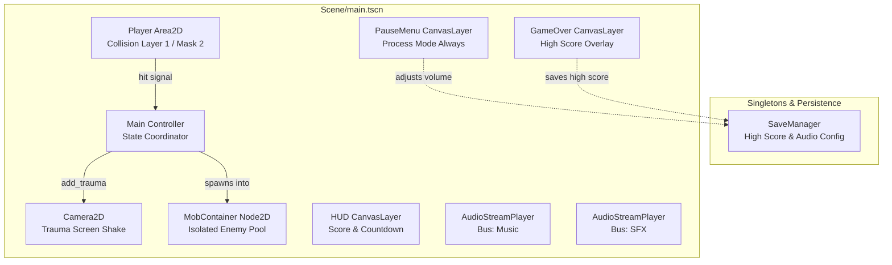

# Dodge the Creeps! 👾

An enhanced, cross-platform 2D survival arcade game built with the **Godot Engine 4.5+**. Dodge incoming creeps for as long as possible, master evasive maneuvers, and set new high scores!

Originally based on the official Godot tutorial, this project has been re-engineered into a release-quality title featuring mobile touch controls, differentiated enemy AI, dynamic difficulty scaling, persistent audio mixing, squash-and-stretch game feel, and an automated headless test suite.

---

## 🎮 Key Features

- **Responsive Cross-Platform Controls**:
  - **Desktop**: Full 8-way keyboard movement with diagonal velocity normalization.
  - **Mobile & Touch**: Smooth screen-drag tracking with deadzone damping to eliminate jitter.
- **Differentiated Creep AI**:
  - 🪰 **Fly**: Fast aerial sprinters with a +25% speed burst.
  - 🐟 **Swim**: Wave-steering creeps with perpendicular sinusoidal oscillation.
  - 🚶 **Walk**: Steady, relentless ground marchers.
- **Dynamic Difficulty Scaling**:
  - Spawn frequency ramps progressively from 0.50s down to a frantic 0.22s as your score increases.
- **Juice & Game Feel**:
  - Procedural squash & stretch scaling during player movement.
  - Trauma-based decaying camera shake upon player collision.
  - Directional particle burst (`CPUParticles2D`) on game over.
- **Audio Architecture & Volume Sliders**:
  - Dedicated bus hierarchy: `Master`, `Music`, and `SFX` via `default_bus_layout.tres`.
  - In-game pause menu with persistent volume sliders stored in `user://savegame.cfg`.
- **Persistent Records & Save System**:
  - High scores tracked and saved across play sessions via `SaveManager`.
- **Robust Mobile Lifecycle**:
  - Full pause menu running in `PROCESS_MODE_ALWAYS`.
  - Automatic game pausing on window focus loss or mobile application suspension.
- **Automated Headless Test Suite**:
  - 44 automated assertions verifying player state, enemy math, audio persistence, and game loop integration without opening the editor.

---

## 🕹️ Controls

| Platform | Action | Input Mapping |
| :--- | :--- | :--- |
| **Desktop** | Move Up | `W` or `Up Arrow` |
| **Desktop** | Move Down | `S` or `Down Arrow` |
| **Desktop** | Move Left | `A` or `Left Arrow` |
| **Desktop** | Move Right | `D` or `Right Arrow` |
| **Desktop** | Pause / Resume | `Escape` or `P` |
| **Mobile / Touch** | Move Character | Drag anywhere across the viewport |
| **Mobile / Touch** | Pause Game | Tap the top-right **Pause (⏸)** button |

---

## 🏗️ Architecture & Scene Structure

The game follows Godot's decoupled, signal-driven architecture:



### Directory Layout

```text
├── .agents/                 # Antigravity development skills & references
├── .github/
│   └── workflows/
│       ├── ci.yml                  # Automated headless CI test gate
│       └── build-and-release.yml   # Windows & Android export pipeline
├── Scene/
│   ├── main.tscn            # Primary gameplay stage
│   ├── player.tscn          # Player character with particles & collision
│   ├── mob.tscn             # Animated enemy body with AI steering
│   ├── hud.tscn             # HUD with score display and start button
│   ├── pause_menu.tscn      # Pause overlay with Music & SFX sliders
│   └── game_over.tscn       # Game over score modal
├── script/
│   ├── main.gd              # State coordinator & spawn scaling
│   ├── player.gd            # Player movement & touch drag logic
│   ├── mob.gd               # Enemy type behaviors & sinusoidal swim
│   ├── hud.gd               # UI presentation & countdown animations
│   ├── pause_menu.gd        # Pause toggling & audio bus adjustments
│   ├── game_over.gd         # Final score presentation & restart signal
│   └── save_manager.gd      # ConfigFile high score & volume persistence
├── tests/
│   ├── test_runner.gd               # SceneTree test runner for CI & CLI
│   ├── test_save_manager.gd         # SaveManager unit tests
│   ├── test_mob_behaviors.gd        # Enemy steering and speed tests
│   ├── test_player.gd               # Player inputs and collision tests
│   └── test_gameplay_integration.gd # Scene tree and audio integration tests
├── default_bus_layout.tres  # Audio bus layout (Master, Music, SFX)
├── export_presets.cfg       # Windows Desktop and Android export presets
├── project.godot            # Engine settings, display, and input mapping
└── LICENSE                  # MIT License
```

---

## 🧪 Running Automated Tests

Tests are executed headlessly using Godot's CLI runner:

```bash
# Windows
godot --headless --path . --script tests/test_runner.gd

# Linux / CI
godot --headless --path . --script tests/test_runner.gd
```

### Test Suite Output
```text
==========================================
DODGE THE CREEPS - AUTOMATED TEST SUITE
==========================================
Running SaveManager Tests...
  [PASS] SaveManager.save_high_score succeeded
  [PASS] SaveManager loaded correct high score
  [PASS] Higher score recognized as new high score
  [PASS] Lower score rejected as new high score
  [PASS] Music volume saved and retrieved
  [PASS] Music bus exists
Running Mob Behavior Tests...
  [PASS] Mob collision_layer is 2 (Enemies)
  [PASS] Mob collision_mask is 0 (No self-collision)
  [PASS] Mob is in 'mobs' group
  [PASS] Mob chose a valid randomized behavior type
  [PASS] Swimming mob oscillates perpendicular to base velocity
  [PASS] Flying mob applies +25% speed sprint
Running Player Tests...
  [PASS] Player collision_layer is 1
  [PASS] Player collision_mask is 2 (scans Mobs)
  [PASS] Default player speed is 400
  [PASS] Player starts at designated coordinates
  [PASS] Player is visible after start()
  [PASS] Collision shape is active after start()
  [PASS] Touch drag event activates touch mode
  [PASS] Target position updated by touch drag
  [PASS] Collision shape deferred disabled on hit
  [PASS] Animated sprite hidden on hit
  [PASS] Death particles triggered on hit
Running Gameplay Integration Tests...
  [PASS] Music is non-spatial AudioStreamPlayer
  [PASS] DeathSound is non-spatial AudioStreamPlayer
  [PASS] Music is routed to Music bus
  [PASS] DeathSound is routed to SFX bus
  [PASS] Main contains MobContainer node
  [PASS] MobContainer starts empty
  [PASS] Mob spawned directly into MobContainer
  [PASS] clear_mobs cleans up container instances
  [PASS] PauseMenu runs with PROCESS_MODE_ALWAYS
  [PASS] PauseMenu includes Music volume slider
  [PASS] PauseMenu includes SFX volume slider
  [PASS] PauseMenu opens when game pauses
  [PASS] SceneTree is paused
  [PASS] PauseMenu closes on resume
  [PASS] SceneTree is unpaused on resume
  [PASS] GameOver starts hidden
  [PASS] GameOver shows on game over
  [PASS] GameOver displays final score
  [PASS] GameOver displays high score
  [PASS] Starting interval is 0.5s
  [PASS] Spawn interval clamps at 0.22s minimum
==========================================
TEST SUITE RESULTS: 44 PASSED, 0 FAILED
==========================================
```

---

## 📦 Building & Exporting

### Desktop (Windows 64-bit)
1. Open Godot Engine and navigate to **Project → Export**.
2. Select **Windows Desktop**.
3. Click **Export Project** and select `export/windows/DodgeTheCreeps.exe`.
4. The executable includes an embedded PCK for standalone distribution.

### Mobile (Android)
1. In **Project → Export**, select **Android**.
2. Ensure Android Build Templates and SDK are installed.
3. Package ID is set to `com.forge.dodgethecreeps`.
4. Orientation is locked to **Portrait** with touch emulation enabled.

---

## 📜 License

This project is licensed under the [MIT License](LICENSE).
Sprite assets and audio belong to their respective creators under Creative Commons licenses from the official Godot Engine tutorial.
