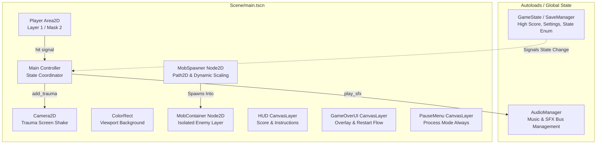

# Architectural Solutions & Refactoring Blueprint

This document details the architectural solutions, design patterns, and concrete refactoring steps to resolve all 10 architectural flaws identified in the **Dodge the Creeps!** Godot 4.5 project.

---

## Architecture Blueprint Overview



---

## Detailed Solutions by Architectural Dimension

### 1. Monolithic "God Node" Resolution
- **Flaw**: `script/main.gd` manages spawning, UI, audio, camera math, scoring, and cleanup.
- **Solution**: Decompose `Main` by delegating responsibilities:
  - **Enemy Spawning**: Extract spawning into a dedicated child node `MobSpawner` (`Scene/mob_spawner.tscn` or script). `MobSpawner` owns `MobPath`, `MobTimer`, and difficulty scaling formulas.
  - **Game State & Scoring**: Move score and session lifecycle to an Autoload `GameState.gd` singleton.
  - **Camera Shake**: Extract trauma shake logic into a reusable `ShakingCamera2D` component extending `Camera2D`.
- **Implementation**:
  ```gdscript
  # script/mob_spawner.gd
  extends Node2D
  class_name MobSpawner

  @export var mob_scene: PackedScene
  @onready var path_follow: PathFollow2D = $MobPath/MobSpawnLocation
  @onready var spawn_timer: Timer = $SpawnTimer

  func start_spawning() -> void:
      spawn_timer.start()

  func stop_spawning() -> void:
      spawn_timer.stop()
  ```

---

### 2. Unification of Game Over Flows
- **Flaw**: `hud.gd` contains deprecated `show_game_over()`, while `main.gd` dynamically instantiates `Scene/game_over.tscn`.
- **Solution**:
  - Remove dead code `show_game_over()` from `script/hud.gd`.
  - Let `HUD` handle in-game display only (score, prompt messages).
  - Treat `Scene/game_over.tscn` as the authoritative Game Over presentation.
  - Pre-instance `GameOver` in `main.tscn` as a hidden `CanvasLayer` (toggled via `.show()` / `.hide()`) instead of runtime instantiation/freeing overhead.

---

### 3. Containerized Enemy Hierarchy (`MobContainer`)
- **Flaw**: Mobs are spawned directly via `add_child(mob)` under `Main`, cluttering the root and requiring global tree searches (`get_tree().call_group()`).
- **Solution**:
  - Add a dedicated `MobContainer` node (`Node2D`) in `Scene/main.tscn`.
  - When spawning, add instances to `mob_container.add_child(mob)`.
  - When resetting or starting a new game, clean up only local container children:
  ```gdscript
  func clear_mobs() -> void:
      for mob in mob_container.get_children():
          mob.queue_free()
  ```

---

### 4. Audio Architecture & Bus Separation
- **Flaw**: Positional `AudioStreamPlayer2D` used for non-spatial global music/SFX; all audio routes to `Master`.
- **Solution**:
  - Change `Music` and `DeathSound` in `Scene/main.tscn` to `AudioStreamPlayer` (non-2D).
  - Create `default_bus_layout.tres` with 3 dedicated buses:
    - **Master** (0 dB)
    - **Music** (routed to Master)
    - **SFX** (routed to Master)
  - Set `bus = &"Music"` on BGM player and `bus = &"SFX"` on sound effects.
  - Expose volume control via `AudioServer.set_bus_volume_db()`.

---

### 5. Type-Safe Cached Node References (`@onready`)
- **Flaw**: Repeated inline `$` and `get_node()` queries.
- **Solution**:
  - Cache all node dependencies using typed `@onready var` annotations at the top of each script:
  ```gdscript
  @onready var animated_sprite: AnimatedSprite2D = $AnimatedSprite2D
  @onready var collision_shape: CollisionShape2D = $CollisionShape2D
  @onready var death_particles: CPUParticles2D = $DeathParticles
  ```
  - Eliminates runtime path lookup overhead and provides compile-time typing.

---

### 6. Correct Spawn Angle Mathematics
- **Flaw**: `direction += randf_range(PI/4, PI/4)` evaluates to static `+45°` with zero variation.
- **Solution**:
  - Change to `direction += randf_range(-PI / 4.0, PI / 4.0)` to allow mobs to deviate ±45 degrees perpendicular to the boundary wall:
  ```gdscript
  var direction: float = mob_spawn_location.rotation + PI / 2.0
  direction += randf_range(-PI / 4.0, PI / 4.0)
  mob.rotation = direction
  ```

---

### 7. Progressive Difficulty Scaling
- **Flaw**: Static spawn interval (0.5s) and static mob speed (150-250 px/s).
- **Solution**:
  - Dynamically scale spawn timer wait time and enemy velocity based on current score:
  ```gdscript
  func update_difficulty(current_score: int) -> void:
      # Scales spawn interval from 0.6s down to 0.25s
      mob_timer.wait_time = clampf(0.6 - (current_score * 0.008), 0.25, 0.6)

  func get_spawn_velocity(current_score: int) -> Vector2:
      var speed_multiplier: float = 1.0 + minf(current_score * 0.015, 0.8)
      var speed: float = randf_range(150.0, 250.0) * speed_multiplier
      return Vector2(speed, 0.0)
  ```

---

### 8. High Score & Settings Persistence (`SaveManager`)
- **Flaw**: Score is lost upon game over; no persistent records.
- **Solution**:
  - Implement a `SaveManager` utility using `ConfigFile` saved to `user://savegame.cfg`:
  ```gdscript
  # script/save_manager.gd
  class_name SaveManager

  const SAVE_PATH := "user://savegame.cfg"

  static func save_high_score(high_score: int) -> void:
      var config := ConfigFile.new()
      config.load(SAVE_PATH)
      config.set_value("records", "high_score", high_score)
      config.save(SAVE_PATH)

  static func load_high_score() -> int:
      var config := ConfigFile.new()
      if config.load(SAVE_PATH) == OK:
          return config.get_value("records", "high_score", 0)
      return 0
  ```

---

### 9. Physics Layer & Mask Segregation
- **Flaw**: All bodies operate on default Layer 1 / Mask 1.
- **Solution**:
  - Configure named 2D physics layers in `project.godot`:
    - **Layer 1: Player**
    - **Layer 2: Enemies**
    - **Layer 3: Boundaries**
  - Configure node masks:
    - `Player (Area2D)`: `collision_layer = 1`, `collision_mask = 2` (Player detects Enemies).
    - `Mob (RigidBody2D)`: `collision_layer = 2`, `collision_mask = 0` (Mobs don't collide with each other or boundaries).

---

### 10. Mobile Lifecycle & Pause Architecture
- **Flaw**: App minimizes or loses focus while enemies continue moving.
- **Solution**:
  - Add an on-screen pause button in `HUD`.
  - Add a `PauseMenu` (`CanvasLayer`) with `process_mode = Node.PROCESS_MODE_ALWAYS`.
  - Listen for system notifications in `main.gd`:
  ```gdscript
  func _notification(what: int) -> void:
      match what:
          NOTIFICATION_APPLICATION_PAUSED, NOTIFICATION_WM_WINDOW_FOCUS_OUT:
              pause_game()

  func pause_game() -> void:
      if is_playing:
          get_tree().paused = true
          pause_ui.show()
  ```

---

## Prioritized Implementation Roadmap for Architectural Refactoring

| Phase | Tasks Included | Expected Impact |
| :--- | :--- | :--- |
| **P1: Quick Fixes & Robustness** | Fix spawn angle math (#6), cache typed `@onready` references (#5), change audio players to non-spatial (#4). | Immediate bugfix, removes audio glitch risks, stops path lookup overhead. |
| **P2: Audio & Physics Layers** | Create `default_bus_layout.tres` (#4), define physics layers & masks (#9). | Independent volume mixing, clean collision boundaries. |
| **P3: Scene Organization & Hierarchy** | Add `MobContainer` (#3), unify Game Over flow (#2), remove dead `hud.gd` code. | Clean scene tree, fast localized cleanup, eliminated UI conflicts. |
| **P4: Gameplay Scaling & Persistence** | Implement progressive difficulty (#7), high score persistence via `SaveManager` (#8). | Long-term replayability and engaging gameplay. |
| **P5: Mobile Lifecycle & Pause** | Implement pause state and background focus detection (#10). | Android-ready polish and zero accidental background deaths. |
