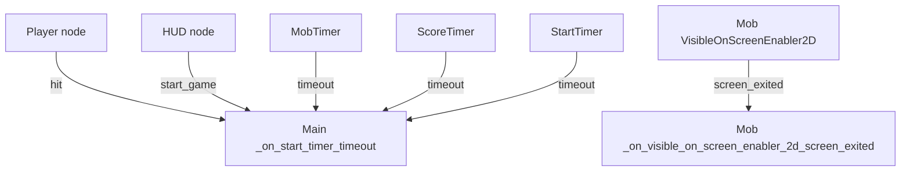
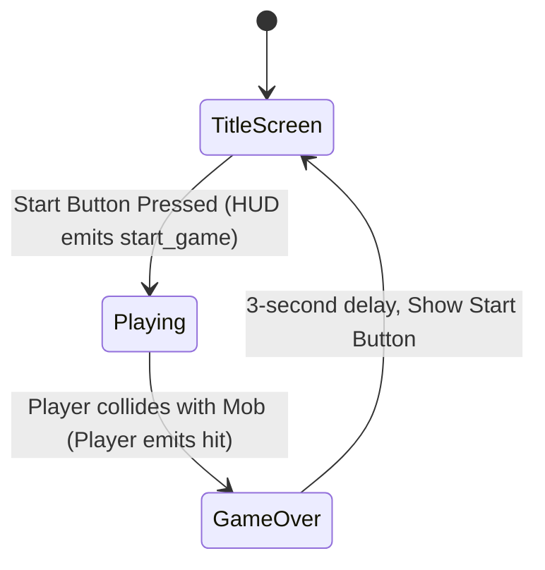

# Current Architecture

This document outlines the existing architecture of the "Dodge the Creeps!" project.

## Repository Structure
```
.
├── art/                   # Visual sprites and audio
├── docs/                  # Engineering and planning documentation
├── fonts/                 # TTF font files
├── Scene/                 # .tscn scene files
├── script/                # .gd GDScript files
├── project.godot          # Godot project configuration
└── README.md              # High-level project intro
```

## Scene Inventory and Hierarchy

### `Main` (`Scene/main.tscn`)
The root game manager.
- `ColorRect`: Background
- `Player` (Instance of `Scene/player.tscn`)
- `MobTimer`: Controls spawn rate
- `ScoreTimer`: Increments score
- `StartTimer`: Initial delay before spawns begin
- `StartPosition`: Player spawn anchor
- `MobPath`: `Path2D` mapping the screen perimeter for enemy spawning
  - `MobSpawnLocation`: `PathFollow2D`
- `HUD` (Instance of `Scene/hud.tscn`)
- `Music`: Background BGM
- `DeathSound`: Game over SFX

### `Player` (`Scene/player.tscn`)
- `Player` (`Area2D`)
  - `AnimatedSprite2D`: Handles walk/up animations
  - `CollisionShape2D`: Capsule collider

### `Mob` (`Scene/mob.tscn`)
- `Mob` (`RigidBody2D`)
  - `AnimatedSprite2D`: Chooses randomly from fly/swim/walk animations
  - `CollisionShape2D`: Capsule collider
  - `VisibleOnScreenEnabler2D`: Despawns mob on screen exit

### `HUD` (`Scene/hud.tscn`)
- `HUD` (`CanvasLayer`)
  - `ScoreLabel`: Top-center score tracker
  - `Message`: Center screen messages (e.g., "Game Over!")
  - `StartButton`: Button to begin a new round
  - `MessageTimer`: Delays message disappearance

## Script Responsibilities and Dependencies

1. **`script/main.gd`**: Central controller. Manages game state (start, game over). Spawns instances of `mob.tscn` around `MobPath`. Controls `ScoreTimer` and communicates with the `HUD` to update UI.
2. **`script/player.gd`**: Listens to keyboard input actions (`move_right`, `move_left`, `move_up`, `move_down`). Calculates velocity, normalizes speed, clamps player to the screen bounds, and emits `hit` signal upon collision (`_on_body_entered`).
3. **`script/mob.gd`**: Simple initialization script. Picks a random animation. Queues free when exiting the screen.
4. **`script/hud.gd`**: Exposes functions to show messages and update the score. Emits a `start_game` signal when the Start button is pressed.

## Signal Connections and Data Flow



## Gameplay Lifecycle



## Player Input Flow
1. User presses WASD/Arrows.
2. `player.gd` checks `Input.is_action_pressed()` during `_process()`.
3. Velocity is modified, normalized by `speed`.
4. Position is updated and `position.clamp` is called to prevent leaving the 360x640 viewport.

## Existing Architectural Strengths
- Clear separation between visual entities (`Player`, `Mob`) and the UI (`HUD`).
- Use of signals for decoupling (e.g., `HUD` does not directly control `Main`, it just emits `start_game`).

## Technical Debt and Architectural Flaws

1. **Monolithic God Node (`Main`)**: `main.gd` acts as a monolithic controller orchestrating enemy spawning, UI state updates, camera trauma math, sound playback, and overlay instancing. It violates the Single Responsibility Principle.
2. **Conflicting Dual Game Over Architecture**: `hud.gd` contains legacy tutorial game over logic (`show_game_over()`), while `main.gd` dynamically instantiates `Scene/game_over.tscn` as a separate CanvasLayer overlay. This leaves dead code and dual conflicting sources of truth.
3. **Flat Scene Hierarchy & Direct Root Instantiation**: Enemies are spawned directly under `Main` with `add_child(mob)`. They share the root branch with UI, cameras, and timers, requiring a global scene tree query (`get_tree().call_group("mobs", "queue_free")`) to despawn enemies rather than containerized cleanup.
4. **Incorrect Audio Node Types & Single-Bus Audio**: Non-spatial background music (`Music`) and game-over sounds (`DeathSound`) use `AudioStreamPlayer2D` instead of standard `AudioStreamPlayer`. Furthermore, all audio routes directly to the default `Master` bus with no independent `Music` or `SFX` bus separation.
5. **NodePath String Hardcoding**: Nodes across scripts repeatedly use inline `$` and string paths rather than cached, typed `@onready var` references, making scene refactoring fragile.
6. **Spawn Angle Mathematics Flaw**: In `main.gd`, `direction += randf_range(PI/4, PI/4)` adds a static 45-degree angle without angular randomness because both range bounds are identical.
7. **Lack of Difficulty Scaling**: The mob timer interval (`0.5s`) and mob speed (`150-250`) are fixed constants. There is no ramp-up in spawn rate, density, or velocity over time.
8. **Missing Global State & High Score Persistence**: All state resides purely in transient scene memory on `Main`. There is no persistent save system (`user://`) or Autoload singleton for high scores or player settings.
9. **Unsegregated Collision Layers**: Physics bodies currently run on default Layer 1 / Mask 1 without dedicated layer filtering between players, enemies, and potential future pickups/boundaries.
10. **Missing Mobile Application Lifecycle Handling**: No pause state or focus listeners exist to suspend the game loop when the application loses focus or is backgrounded on Android.
